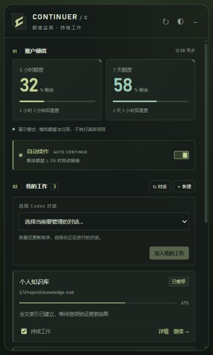

# Codex Continuer

[](https://github.com/empty610/codex-continuer/actions/workflows/windows.yml)

监测 Codex 账户额度，在额度恢复后接续指定工作，并通过跟随 Codex 窗口的桌面挂件查看状态。

**开发版本：0.4.1-preview · Windows x64 预览版 · GPL-3.0-only。** 这是独立社区项目，与 OpenAI、Rhine、Clash Verge 无隶属关系。

本对话后续更新统一记录在 `0.4.1-preview` / `preview/0.4.1`。旧版 `0.4.0-preview.1` 文件保留；版本切换按用户明确指令进行，开发更新不合并到 `main`。

## 功能

- 显示短期、长期额度与重置倒计时；数据未知或超过 90 秒时等待新样本。
- 导入原聊天，确认额度耗尽并恢复后，向原聊天排队发送一次固定“继续”。
- 新建带目标和验收标准的工作，按额度、轮次上限和审批状态推进。
- 提供紧凑仪表、任务面板、托盘、窗口跟随与独立显示；隐藏时暂停界面订阅和动画。
- 本地保存任务与备份，提供存储恢复；所有本地 API 都要求访问凭据。

| 紧凑仪表 | 任务面板 |
| --- | --- |
|  |  |

截图使用演示数据，拍摄于旧版，仅供界面参考。

## 安装

运行需要 Windows x64、Node.js 22.12+（推荐 24），以及已安装、登录并支持插件的 Codex CLI。原聊天接续还需要支持 `queue --thread --message` 的桌面 CLI。源码编译额外需要 Visual Studio Build Tools 的 MSBuild/Roslyn；便携包不需要编译工具。

### 从源码安装

```powershell
git clone https://github.com/empty610/codex-continuer.git
cd codex-continuer
.\Install-Plugin.ps1
```

安装器先检查 Node/Codex 能力，再安装依赖和 Electron、构建插件、注册本地市场并打开挂件。首次安装后重载 Codex 插件或打开新聊天。打开挂件不会开启调度。

### 使用便携包

可从通过检查的 [Actions 构建](https://github.com/empty610/codex-continuer/actions/workflows/windows.yml) 下载 `continuer-windows-portable` 产物。完整解压后，在包含隐藏目录 `.agents` 的市场根目录执行：

```powershell
.\Install-Portable.ps1 -Open
```

不要移动或删去包内文件。完整安装与卸载步骤见 [便携包说明](docs/portable.md)。

## 使用

1. 在 Codex 中让插件“打开 Continuer 挂件”，也可从源码或插件目录运行 `Open-Widget.cmd`。
2. 导入已有会话后保持暂停；检查所选聊天，再手动开启额度监测。新建工作需要填写项目绝对路径、目标和验收标准。
3. 明确开启调度或继续工作后才执行。点击仪表展开，拖动移动；Ctrl+Alt+C 展开面板，右键或托盘可调整跟随与显示。

两种模式的含义：

| 模式 | 接续行为 | 停止条件 |
| --- | --- | --- |
| 导入原聊天 | 一次确认的耗尽恢复周期，向原聊天发送一次“继续”；备注仅本地保存 | 暂停、发送次数到限或发送结果不确定；不自动识别原聊天目标完成 |
| 新建工作 | 按原始目标启动执行轮次，要求结构化完成结果 | 完成、阻塞、无工具活动或轮次到限；模型报告完成仍需核对验收 |

浏览器控制台通过 `Start-Continuer.ps1` 打开；启动器提供本地凭据，页面会清除链接中的令牌。不要分享启动链接。隐藏到托盘仍保留运行；点击关闭按钮或选择“退出 Continuer”会保存状态、停止后台服务和监听器，并结束进程。停止超时后仅清理经安装路径核验的所属服务进程树。退出后，普通状态查询和自动启动不会重新拉起；手动打开挂件或浏览器启动器可恢复。

启用或关闭随 Codex 启动：

```powershell
.\Enable-Autostart.ps1
.\Enable-Autostart.ps1 -Disable
```

卸载时在实际安装的插件目录运行 `Uninstall-Plugin.ps1`，依次关闭自启动、停止服务、退出挂件并移除插件。任务数据会保留。

## 开发与验证

```powershell
npm ci
node node_modules/electron/install.js
npm run check
npm run check:public
npm test
npm run doctor
npm run build:release
```

`doctor` 只检查版本和帮助信息，不调用模型或发送消息。测试使用独立数据与模拟 RPC/队列，并包含隐藏 Electron 窗口检查。本机已通过 243 项回归；托管 CI 状态以上方徽章和对应提交的工作流结果为准。

`build:release` 生成便携压缩包、同版本源码归档、`release.json` 和 `SHA256SUMS`。分发二进制时须配套提供源码归档。编译器可通过 `CONTINUER_CSC` 指定。

## 范围与隐私

- 当前主要验证 Windows x64、Node.js 24、Codex CLI 协议基线 0.153.2；外部接口升级可能需要适配。
- 电脑、服务和原聊天执行端必须可用。排队成功不等于任务完成；已进入 Codex 队列的消息不能由本工具撤回。
- 跨机器、完整真实额度耗尽恢复和长期无人值守仍待验收；原生监听器尚未代码签名。
- 凭据由 Codex 管理；本工具的任务、输出、路径、备注和日志仍可能包含私人信息。不要上传 `data/`、`.cache/`、`runtime.json`、令牌或未脱敏诊断。
- 本地访问控制不防御能够读取同用户数据目录、浏览器会话或进程内存的程序，不支持公网部署或多人共享。

更多内容见 [文档索引](docs/README.md)、[使用细节](docs/usage.md)、[运行与恢复](docs/operations.md)、[兼容性](docs/compatibility.md)。

## 许可与反馈

项目按 [GPL-3.0-only](LICENSE) 分发。动画和像素数字改编自 Rhine，原件、来源提交与修改说明见 [第三方声明](THIRD_PARTY_NOTICES.md) 和 `third_party/rhine/`。

普通问题提交到 [Issues](https://github.com/empty610/codex-continuer/issues)；安全问题按 [SECURITY.md](SECURITY.md) 私下报告。参与开发见 [CONTRIBUTING.md](CONTRIBUTING.md)，版本变化见 [CHANGELOG.md](CHANGELOG.md)。
