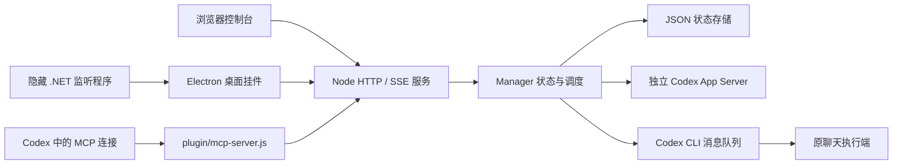

# Continuer 内容、架构与优化评估

评估日期：2026-10-24，Asia/Shanghai。对象：本地 0.3.3 源码与当前运行实例，包含最近两轮窗口层级和内存优化。

> 2026-10-25 已完成[第二轮评估](project-evaluation-round2.md)。本文保留第一轮历史发现与修复记录；当前仍待处理的缺陷以第二轮报告为准。桌面架构继续使用 Electron，已移除替代容器迁移研究计划。

> 文件整理更新：历史调查已移入 `docs/history/`，保留的界面参考位于 `docs/images/`，内存原始资料位于 `data/diagnostics/desktop-memory/`；一次性探测脚本和测试 profile 已清理。资料索引见 `docs/README.md`。下文保留评估当时的发现，其中 A12 的历史资料分类已完成。

> 修复更新：2026-10-24 已完成 A01 的并发导入防护，新增 7 项回归，总计 85 项测试通过。历史评估和修复前证据仍保留；当前证据见 `.cache/project-evaluation/evidence.json`，修复前结果见 `.cache/history/project-evaluation-before-import-fix.json`。

> 后续修复：已完成 A03 的输出片段合并保存和无用快照优化，再新增 10 项回归，累计 95 项测试通过。1000 个突发片段的整份状态保存从 1000 次降至 1 次；修复前证据另存于 `.cache/history/project-evaluation-before-output-batching.json`。

> 输出上限修复：A04 已完成，增量和完成消息统一限长，结构化结果独立保存；新增 12 项回归，累计 107 项测试通过。旧版本保存的超长输出会在加载时收缩。修复前结果见 `.cache/history/project-evaluation-before-output-limit.json`。

> 轮次隔离修复：A05 已完成，轮次通知与审批核验当前执行代次、聊天 ID 和轮次 ID，失效子进程的输入直接忽略。新增 26 项回归，累计 133 项测试通过。修复前证据见 `.cache/history/project-evaluation-before-turn-isolation.json`。

> 轮询与模式修复：A06、A07 已完成。轮询范围收紧为 10–90 秒，原聊天使用可选本地备注、独立累计发送上限及“结束监测”语义。新增 16 项测试并扩展真实 HTTP/MCP 回归；累计 149 项通过。修复前证据见 `.cache/history/project-evaluation-before-monitor-policy.json`。

> 综合优化：A02、A08、A09、A10、A11、A12 的本地可落地改进已完成，新增 22 项回归，累计 171 项通过。状态校验/备份/恢复、故障停调度、查询冷启动、摘要与按需详情、SSE 背压、日志轮转、资源上限、构建指纹/清单/便携模式、运行健康和界面说明已落实。本轮建立本地 Git 基线，提供 Windows CI 流程；远程 CI 尚未触发。运维方式见 [运行、恢复与发布](operations.md)，修复前证据见 `.cache/history/project-evaluation-before-general-optimization.json`。

## 1. 总体判断

Continuer 已经具备个人日常使用的完整功能闭环：查看额度、管理新工作、监测原聊天、额度恢复接续、审批、暂停、桌面跟随、自启动和诊断。核心价值明确，额度未知时不运行、发送结果不明时不重发等保守规则也比较扎实。

当前更适合定位为 **Windows 本地个人效率工具**。本轮已补齐可落地的并发、存储、模式、发布与诊断边界；面向公开发行时仍需托管 CI、干净设备验证与长期运行测量。继续压缩内存有空间，但直接重写整个桌面容器不是当前收益最高的第一步。

最初评估阶段仅新增报告与隔离探测脚本；后续已按上方修复进展修改代码并验证。评估及回归中的执行、发送均使用替身，没有调用模型或向真实聊天发送消息。

| 维度 | 当前判断 | 主要依据 |
| --- | --- | --- |
| 功能完整度 | 较完整 | 额度、调度、原聊天接续、审批、桌面和浏览器入口齐全 |
| 核心策略 | 较扎实 | 新鲜额度样本、串行锁、发送前持久化、结果不明停发、人工审批 |
| 稳定性 | 故障边界已补强 | 保存失败停调度，格式校验、有效备份、明确恢复和服务写入锁已落实 |
| 性能 | 高频路径已收缩 | 输出合并、限长、摘要推送、详情按需读取、背压和日志轮转已落实 |
| 产品说明 | 两种模式已明确区分 | 执行目标与监测备注、执行轮次与发送次数、标记完成与结束监测各自对应实际行为 |
| 测试 | 171 项通过 | 新增真实服务冷启动、损坏恢复、全部界面模块路由和构建完整性检查；真实用户任务及长期泄漏仍未自动验收 |
| 发布与维护 | 可校验的本机/便携构建 | 版本来源、运行指纹、协议/schema、干净暂存打包和 Windows CI 流程已提供；托管 CI 尚未执行 |

这是一份产品与工程评估，包括现有隔离措施的代码检查；没有执行专门的全面安全扫描、依赖漏洞扫描或长期泄漏分析。

## 2. 项目内容与能力边界

### 2.1 两种不同的工作模式

| 项目 | 新建并直接执行的工作 | 导入原聊天的额度监测 |
| --- | --- | --- |
| 创建方式 | 新建工作 | 导入已有聊天 |
| 执行端 | Continuer 自己的 `codex app-server` | 原聊天的桌面执行端 |
| 接续方式 | `thread/start/resume`、`turn/start` | CLI 队列发送自定义续作消息，留空发送“继续”（0.5.0-preview） |
| 启动条件 | 开启调度、任务排队、真实额度达标 | 先观察到额度耗尽，再观察到恢复且达标 |
| 用户输入 | 目标进入实际执行提示词 | 可选本地监测备注，不发送 |
| 上限 | maxRounds，直接执行轮次 | maxWakeSends，每条记录累计确认排队次数 |
| 进度与完成 | 使用本工具收到的计划和结构化结果 | 不同步外部执行计划，不自动核验原聊天完成 |
| `maxRounds` | 在执行前检查 | 使用独立 maxWakeSends 限制累计发送 |
| 点击“继续” | 重新排队等待额度 | 开启并重置监测，不立即发送消息 |

当前界面已分别使用直接执行目标与监测备注、执行轮次与发送次数、标记完成与结束监测，避免相同文案承诺不同行为。

### 2.2 已有功能

- 额度：多额度桶、双时间窗口、采样时间、重置倒计时、历史趋势；倒计时不替代真实额度确认。
- 任务：新建、导入、暂停、继续、单项持续开关、全局调度开关、计划、输出、活动、轮次、人工完成。
- 执行约束：直接任务串行；工作区沙箱和人工审批；不明确结果停止自动执行；完成任务清出列表。
- 原聊天监测：每次耗尽/恢复周期最多尝试一次确定发送；发送前记录状态；不确定结果停止自动重发。
- 桌面：普通窗口层级、独立/跟随、位置记忆、紧凑卡片、展开面板、托盘、快捷键、大小调整、自启动。
- 界面：完整浏览器控制台、桌面挂件、深浅主题、动画和减少动态效果支持。
- 运维：启动/停止脚本、演示模式、MCP 插件、白名单打包、状态与日志文件、协议探测记录。

### 2.3 应明确保留的边界

1. 队列接收成功不等于模型已开始、目标已完成或验收通过。
2. 监测原聊天不等于接管原聊天；开启时额度健康不会立即发送“继续”。
3. 导入记录使用可选本地备注，不作为新目标发送；原聊天中的用户要求继续起作用。
4. 全局调度关闭只阻止新动作，不自动中断已经运行的轮次；单项暂停才请求中断直接任务。
5. 完成状态由模型的结构化结果或用户确认产生，不是独立验收器。
6. 本地服务和电脑必须运行；断电、休眠与执行端不可用时不能保证接续时效。
7. 已发送的队列消息不能通过本工具撤回。

## 3. 架构评估

### 优点

- 后台服务与窗口解耦，符合“隐藏/退出挂件后仍继续工作”的要求。
- 后端仅使用 Node 内置模块，部署与依赖面相对小。
- 策略、恢复监测、消息队列、持久化和桌面几何均已有独立模块。
- 浏览器和桌面共用 API，保留了桌面外壳替换的空间。
- 进程启动普遍使用参数数组、隐藏窗口；队列不覆盖模型、沙箱或审批策略。
- 最近将窗口枚举迁至隐藏监测程序，减少 PowerShell 运行时常驻开销，是有效的局部改造。

### 结构性负担

- `Manager` 同时管理两种任务、持久化、RPC 通知、审批、迁移和调度；新增行为容易影响其他状态。
- 浏览器与挂件仍有各自的渲染外壳；模式文案、详情缓存和存储提示已抽成共享模块，进一步重构需由实际维护需求驱动。
- 版本、路径、端口、数据目录和 CLI 发现规则分散在多个文件，升级时难以保证一致。
- JSON 存储适合当前规模，但同步全量写入与缺少恢复路径限制了长时间运行的可靠性。
- 桌面涉及 Electron、.NET、PowerShell、Node 和两种 Codex CLI 选择路径；应减少契约分歧，暂不再新增运行时。

建议将业务拆成 `ExecutionTaskService`、`QuotaWakeService`、`ApprovalService` 和 `PersistenceCoordinator`，仍由一个服务进程承载。此处拆的是职责，不是增加微服务或进程。

## 4. 已验证问题与优先级

优先级：P1 表示应先处理的正确性/可用性问题；P2 表示近期优化；P3 表示内容和维护整理。以下“已复现”均指隔离环境中的确定结果，不代表生产实例已经发生该事故。

### A01 · P1：并发导入可造成重复恢复消息【并发导入防护已修复】

修复：异步读取前按聊天 ID 保留导入名额，失败时在 `finally` 中释放，提交前再次检查任务唯一性。已用 20 个并发请求及 HTTP/MCP 混合入口验证只保存一条暂停记录，一次额度恢复只产生一次模拟发送；读取失败可重试，不同聊天互不阻塞。现有任务数据没有重复聊天记录，本次未迁移或修改真实任务。

以下为修复前的原始发现：

位置：`server/manager.js:292–297`。

重复检查发生在 `await thread/read` 之前，等待返回后没有再次确认唯一性。两个请求可以同时通过检查并各自插入一条记录。

本次对同一个聊天并发导入两次，得到 **2 条记录、1 个聊天 ID**；同时开启后，一次模拟耗尽/恢复产生 **2 次模拟队列发送**。单一 `scheduling` 锁无法消除已经重复的记录。

建议：按 `threadId` 合并进行中的导入操作，提交前再次校验；启动迁移时处理历史重复记录；把“一聊天一有效监测记录”作为不变量。不要仅依靠前端禁用按钮。

验收：20 个并行导入请求最多产生 1 条记录，单次恢复仅发送一次；失败重试不遗留半成品记录。

### A02 · P1：持久化错误直接传播，缺少运行时降级【本地容错已落实】

修复进展：集中保存失败诊断并关闭后续调度，RPC 通知与后台轮询捕获异常；暂停仍尝试中断工作。状态 schema 校验、最近有效备份、明确重试/恢复入口、损坏主文件保留和单数据目录服务锁已落实。发送和批准前先确认保存，失败不越过持久化边界。恢复备份后停止全部记录，对可能已发送的 outbox 保持不确定，需检查原聊天再继续。下面保留修复前的原始发现。

位置：`server/store.js:11–14`、`server/manager.js:67`、`server/rpc.js` 的通知分发。

每次状态变动直接同步保存。隔离注入 `EACCES` 后，输出通知处理直接抛错。在真实 RPC 事件监听器中，这条路径没有统一捕获；如果存储异常落在此处，会成为未捕获异常并导致服务退出。

JSON 语法损坏会显式报错，优于静默清空任务；但目前没有可恢复备份、状态 schema 校验或用户可操作的恢复流程。

建议：集中处理保存异常，停止后续调度和队列发送，向 UI 显示“数据保存失败”；增加最近一次有效备份、schemaVersion、启动校验与明确恢复入口。不要在保存失败后假装发送前状态已经可靠落盘。

验收：拒绝写入、文件占用和损坏 JSON 时，能给出明确诊断；关键动作不越过保存失败；修复存储后能恢复；旧文件不会被错误覆盖。

### A03 · P2：输出片段逐条同步写整份状态【合并保存已修复】

修复采用从首个片段起固定 250 ms 的保存窗口，多个任务共享一份待写状态，避免连续输入造成无限延迟。内存和变更通知即时更新；完成消息、暂停、审批、配置、任务结束以及 outbox 状态仍走即时保存，并取消冗余计时器。`stop()` 和 `shutdown()` 补写尚未保存的输出。

`change` 改为失效通知，HTTP 层在需要广播时才构建快照；没有 SSE 客户端时跳过广播序列化。后台保存失败被捕获并写入服务错误日志，待写状态保留，未将存储失败伪装成保存成功。

隔离复测：1000 个 64 字符突发片段，处理过程中 0 次保存，显式补写后共 1 次，序列化 16883 字节；原实现为 1000 次、14891000 字节。持续输出的受控时钟测试在 1 秒内保存 4 次，多任务交错输出均正确保留。另验证了真实文件重启恢复、正常停止、等待中断期间的尾部输出、关键状态即时保存、保存失败重试以及 outbox 保存失败时不发送。95 项测试全部通过。

普通输出有约 250 ms 的暂存窗口，事件循环繁忙时计时可能延后；强杀或断电可能丢失未落盘片段。发送前的关键状态不采用此延迟策略。本次仍保存整份 JSON，仅合并高频片段；大输出拆文件与局部 SSE 更新属于后续优化。

以下为修复前的原始测量：

位置：`server/manager.js:67、188、215`，`server/store.js:11–14`。

1000 个 64 字符输出片段产生 **1000 次同步全量写盘**，序列化约 **14.9 MB（十进制）**，本机该次突发测试约 **564 ms**。时间包含该设备的文件系统开销，不是通用性能保证。

HTTP 广播已经有 150 ms 合并，但持久化没有同步合并。`changed()` 还会构建一个发送给监听器的快照，而 HTTP 监听器并未使用它，广播时又构建一次。

建议：输出、进度和普通活动采用 100–300 ms 合并保存；避免无用快照；仅广播实际变化的部分或按需读取详情。**发送前 outbox 状态、发送确认、暂停、审批和关键设置仍需即时确认保存成功**，不能把所有保存一律延迟。

验收：持续普通输出时常规写盘不超过约 4 次/秒；最终输出和关键状态可恢复；发送防重规则不退化。

### A04 · P2：完成消息绕过输出长度限制【已修复】

实现位置：`server/output.js`、`server/manager.js`、`server/policy.js`；浏览器与桌面详情页均显示截断提示。

增量和完整回复统一保留末尾最多 16000 个 UTF-16 单元，边界避免拆开 Unicode 代理对。收到完整回复时先解析原始 JSON，再独立保存 `{status, summary}`，摘要最多保留前 2000 个 UTF-16 单元，多余字段不保留，避免通过摘要、活动和日志再次引入超长文本。每轮开始清空结果，后续消息与新片段会替换或失效旧结果；无效结果仍停止自动续作，无工具活动的 continue 仍被阻止。

隔离复测：262144 字符完成消息保留 16000 字符，状态文件为 17171 字节；同长度的超长摘要和额外字段不会被全文保存，done/continue/blocked 分别仍得到 completed/queued/blocked，完成消息处理后的快照约 19 KB。真实文件测试覆盖 2 MiB 摘要及旧文件迁移；107 项测试和 JavaScript 语法检查全部通过。

保存和快照仅包含截断预览，完整内容需查看原 Codex 会话；没有新建全文归档。加载旧状态时会收缩超长 output，当前内存处理一条完整 RPC 消息时仍需短暂接收、解析原始文本。

原始发现保留：增量输出原先只保留最后 16000 字符，但 `item/completed` 直接赋值完整文本，262144 字符完成消息全部保留并写入约 263 KB 状态文件，扩大后续保存、SSE 和 DOM 开销。

### A05 · P2：旧轮次完成事件可改变当前轮次【已修复】

实现位置：`server/manager.js`、`server/rpc.js`。回归：`tests/turn-events.test.js`、`tests/rpc.test.js`。

完成、开始、计划、输出、工具和审批消息现在统一核验聊天 ID、当前轮次 ID 和运行状态；若同时存在 `turnId` 与 `turn.id`，两者必须一致。缺少 ID、旧轮次、重复完成以及已结束轮次的迟到开始事件不会修改任务、审批、更新时间或触发保存。轮次完成后清空当前 ID，旧开始通知不能重新绑定它。

`turn/start` 响应是轮次 ID 的确认来源。响应前的消息暂存，收到响应后只应用匹配的消息，兼容先通知后响应和快速完成。暂存最多 256 条、4 MiB；超限清空部分结果、拒绝暂存审批，待获知轮次 ID 后中断，不采用不完整证据判断完成。中断失败会进入 blocked，不能声称已暂停。断连会使未完成的启动流程失效，旧响应或错误不会覆盖后续执行。

RPC 每条输入先检查来源子进程仍是当前连接，替换或关闭后旧通知、请求和响应全部忽略。关闭时立即撤销连接并拒绝未完成调用；初始化响应后再次检查连接，避免退出或关闭后重新变成 ready。

隔离复测：当前轮次为 current-turn，收到 obsolete-turn 完成事件后任务仍为 running，保留 1 条记录。26 项新增回归覆盖旧/重复/乱序通知、真实两轮切换、审批归属、暂停、重启、迟到启动结果、缓存上限以及伪子进程重连和初始化竞态；演示 RPC 的先通知后响应流程仍正常完成。133 项测试与语法检查通过；没有启动真实模型任务或发送聊天消息。

原始发现保留：事件只按聊天 ID 匹配，没有核验 `p.turn.id`；在隔离构造的旧轮次完成通知下，当前记录被误标完成并清除。这证明原实现缺少防护，未证明真实 Codex 正常连接发生过同类失序事故。

### A06 · P2：允许的轮询周期超过额度有效期【已修复】

后端设置、MCP schema、浏览器选择项和挂件输入统一限制为 10–90 秒，额度有效期保持 90 秒。旧状态超过 90 秒的配置在加载时收紧并保存，调度开关不变。发送通道预检后、真正排队前再次要求新鲜额度样本。

受控时钟验证第 90 秒刷新；超过 90 秒的样本继续拒绝续作。HTTP/MCP 拒绝 91 秒及 300 秒配置，且无部分设置变更。网络或事件循环繁忙时仍可能延迟刷新，此时继续等待新样本，不延长有效期。

原始发现保留：轮询曾允许 300 秒，超过 90 秒额度有效期，可能在一个周期中留下约 210 秒无法启动任务的等待区间；原策略未错误放行过期额度。

### A07 · P2：原聊天模式的目标、次数上限和完成承诺不一致【已修复】

原聊天导入改为可选 note，仅本地保存；旧 prompt 参数仅作为备注兼容，不能与 note 同时提交。历史目标迁移为备注，历史 rounds 发送计数迁移为 sentCount；旧 writer-wait 的直接执行轮数不会计为发送。原聊天快照不提供推测进度，详情提示在原聊天查看。

新增 maxWakeSends（1–100），每条记录累计计数，与直接执行 maxRounds 独立；默认 20，旧配置首次沿用原 maxRounds。到限停止监测，暂停、重开和重启不清零；降低上限立即阻止超限记录的新发送，提高上限仍需明确开启监测。排队前重新检查开关、记录存在、发送预算和额度有效期。已经进入排队过程的消息不能撤回，其成功结果仍计数；发送结果不明保持 blocked，不自动重发。

浏览器、挂件和 MCP 均明确：原聊天 resume 只开启额度监测，pause 不打断原聊天，complete 仅结束监测并移除；不承诺识别或完成原聊天目标。确认排队成功只记录消息成功，不记为工作完成。新建工作仍使用目标、轮次和结构化完成结果。

隔离复测：发送上限 1、直接执行上限 100，两个耗尽恢复周期只发送一次，累计 1 次后 paused 且 continuous=false。新增 16 项回归并扩展 HTTP/MCP 实例测试，覆盖迁移、上限、重启、发送中修改设置、过期样本、备注隐私以及两套真实详情渲染函数。149 项测试、语法检查通过，没有向真实聊天发送消息。

原始发现保留：导入“继续目标”未实际发送，maxRounds 不限制监测发送，界面曾承诺外部完成自动停机，MCP resume 描述与监测行为不一致。

### A08 · P2：只读工具的冷启动存在调度副作用路径【已修复并集成验证】

MCP/挂件的服务冷启动一律附带查询模式，屏蔽保存的调度开关但不改写其偏好；仅明确开启调度、创建或继续工作才退出查询模式。导入保持暂停。真实进程集成用预存 queued 工作及 armed 恢复记录验证：读状态、列会话、刷新额度后，模型轮次与发送计数均为 0；明确激活后各执行一次替身动作。下面保留原始发现。

位置：`plugin/tools.js:29`、`plugin/runtime.js:29–48`、`server/index.js:72`、`server/manager.js:96–101`。

状态/会话列表工具也会调用 `ensureService()`。服务未运行时，它会启动后台；后台随后按保存的 `enabled` 设置刷新并调度。如果保存状态中存在可运行任务，读取状态可能与启动任务发生在同一次冷启动中。

这与“读取状态不启动任务”的产品承诺存在边界冲突。也可能是用户之前明确开启调度后希望恢复的行为，需要产品层面定义，不能只依靠 MCP 的 `readOnlyHint`。

建议：区分只读冷启动和明确恢复调度，或提供无需启动调度器的只读状态路径。补一条冷启动集成测试，确认每种入口的任务启动计数。

本次没有在真实任务上验证此路径，以免改变用户工作状态。

### A09 · P2：SSE 与日志缺少资源上限【资源边界已落实】

SSE 最多 16 个连接，每个连接仅保留一帧未排空状态，单帧最多 1 MiB；持续背压或 15 秒未排空则断开，drain 后移除临时监听器，防止监听器累积。广播不带目标、备注、计划和输出，详情单独读取；隔离样本 17193 字节完整快照缩为 948 字节任务摘要（HTTP 另附少量诊断字段）。保存 300 条活动，摘要带 50 条，导出可取全部已保留日志。日志按 1 MiB/3 副本轮转，原生重定向每 60 秒检查。新增任务 100、会话选择 300、审批 50、计划 100 步；并发导入提交时再次检查容量。下面保留原始发现。

位置：`server/index.js:26、49`、`plugin/runtime.js:21–24`。

SSE 忽略 `write()` 返回值，没有慢客户端策略；长期不读取的客户端可能让发送缓冲增长。桌面和服务日志采用追加写入，没有大小轮转。任务数和会话选择列表也缺少明确上限或虚拟化策略。

建议：慢客户端仅保留最新快照或主动断开重连；限制连接数量并收集丢弃计数；日志按大小/数量轮转；任务摘要与详情拆分。不需要为当前小规模立即引入复杂消息队列。

### A10 · P2：构建包绑定本机路径，升级身份不足【本机与便携构建已改进】

运行版本从 package.json 读取，代码内容指纹、协议和 schema 明确显示；MCP 启动校验服务构建一致性。打包使用干净暂存目录、全文件 SHA-256 清单和替换，验证修改/缺失/多余文件；保留旧本机数据位置，新增无本机绝对路径的 portable 配置与稳定用户数据目录，启动、自启动和挂件共用配置。Windows CI 脚本已提供，尚未在远程托管环境执行；本地 Git 基线与构建验证见本轮交付记录。下面保留原始发现。

位置：`scripts/build-plugin.js:35`、`plugin/runtime.js:35`、各启动脚本和版本常量。

`runtime.json` 固定源码目录下的数据路径和当前 Node 绝对路径；同为 0.3.x 即可被认为兼容。当前项目、已安装缓存和运行服务可能是不同批次代码，却仍展示相同版本。构建向现有目录覆盖复制，未验证旧文件是否残留。

源码当前目录没有 `.git`，也没有 `.github/workflows`；这只是本地目录现状，不代表不存在外部备份。

建议：统一版本来源，增加 buildId、配置/协议/schema 版本；诊断显示源码/安装/运行版本；默认数据移至稳定的用户目录并提供迁移；分离本机构建与可分发包；临时目录打包后做清单校验再交付。先建立版本控制、回滚和 Windows CI，再扩大分发。

### A11 · P2：生命周期缺少统一的健康状态【诊断与有限恢复已落实】

新增 /api/health，报告服务、存储、上次退出、挂件 ready/PID、构建、自启动监听器与资源计数。服务记录明确退出或意外退出线索；旧锁由存活检查决定是否回收。打开挂件等待首屏成功渲染的 ready 信号，隔离隐藏窗口已验证 ready 与退出；渲染进程异常最多重新加载 3 次，手动退出不自动重启。没有引入持续模型心跳或自动恢复任务调度。下面保留原始发现。

位置：`desktop/monitor.cs:73–91`、`plugin/runtime.js`、`server/rpc.js`。

监听器根据 Codex 窗口标识变化触发打开，符合“手动退出后不马上重开”的要求；但服务或挂件意外退出时，没有统一区分“用户主动停止”和“崩溃”。`openWidget()` 的成功返回也只代表已发起启动，并不等于窗口已就绪。

建议：增加 `/api/health`、启动结果确认、停止原因和最近心跳。意外退出可有限重试；明确手动退出/停止时保持停止。不要为了自愈而破坏用户主动退出的现有约定。

### A12 · P3：版本、帮助、品牌与历史文档不同步【当前界面与说明已同步】

浏览器、MCP、RPC clientInfo 与挂件读取统一版本，界面显示 buildId；去掉旧的“未配置自启动”断言，改为显示真实监听器/偏好诊断。浏览器与插件品牌统一到 Rhine 色板，布局交互不变；历史截图仍明确标注参考。修复上一轮漏挂 task-mode.js 静态路由的问题，集成测试递归检查两个入口导入的全部页面模块均可读取。下面保留原始发现。

- `public/index.html:16` 仍显示 v0.1.0，后端和包为 0.3.3；RPC clientInfo 也保留 0.1.0。
- 浏览器设置仍写“本版本未配置开机自启”，与已有脚本和运行状态冲突。
- 插件 metadata 仍为紫色品牌，挂件使用 Rhine 暖灰/琥珀/浅绿，浏览器也有另一套配色。
- 旧的 writer-conflict 方案、桥接研究和后续 queue 方案均保留，但缺少“当前方案”索引。
- 截图来自 2026-10-22，部分截图仍展示已完成任务，与现在自动清理的行为不同。

建议：README 前半部分先解释用途、两种模式和启动方式；视觉/动画来源放到设计与许可证章节；建立当前架构文档，历史调查单独标明已被替代的结论；生成版本文本；增加实际自启动状态显示。

## 5. 内存、CPU、I/O 与分发体积

### 5.1 当前内存统计应按完整进程组看待

2026-10-24 12:41 左右，独立模式、160 px、收起状态、本机 1 条管理记录的进程快照：

| 组件 | 进程数 | 私有提交量 MiB |
| --- | ---: | ---: |
| Electron 主进程/GPU/网络/渲染 | 4 | 155.6 |
| 隐藏监听器 | 1 | 16.7 |
| Node HTTP 服务 | 1 | 62.7 |
| 该服务的 Codex App Server | 1 | 24.8 |
| Codex 宿主管理的 MCP 连接 | 4 | 80.4 |
| 合计 | 11 | 340.2 |

窗口与监听器小计为 **172.3 MiB**。此前 321–327 MiB 的数字是窗口重启后短时采样，并且不含服务与 MCP；不能直接与本表的完整范围作升降对比。

这是 Windows 私有提交量快照，不是独占物理内存，也不是峰值或长期均值。MCP 进程数由宿主连接生命周期影响，观察到 4 个进程本身不能证明泄漏。本次没有结束这些连接。浏览器另外打开的页面不在本表内。

最近两轮已经完成的优化有效：移除普通窗口置顶、独立模式不启动跟随、窗口枚举减少分配、监听器从常驻 PowerShell 改为约 17 MiB 的隐藏程序。后续常规收益应主要来自减少无用快照、整份写盘和 DOM 更新。

### 5.2 桌面运行时路线

本机 Electron 运行时目录约 **356.8 MiB**，当前隐藏监听程序只有 **12 KiB**。运行时体积、内存和压缩安装包体积是不同指标。

| 路线 | 价值 | 成本/风险 | 建议 |
| --- | --- | --- | --- |
| 保留 Electron，优化数据与渲染 | 保留现有动画、拖动和生态；风险低 | 浏览器运行时基本开销仍在 | 当前主线 |
| 纯原生紧凑卡片、按需打开网页面板 | 紧凑模式可不常驻网页渲染 | 当前 SVG/CSS 动画不能原样复用；视觉与维护成本较高 | 作为可选轻量模式研究 |

当前继续使用 Electron，并优先优化数据与渲染路径。可选原生紧凑卡片只保留成本分析，不列入实施计划。

### 5.3 应建立的性能基线

- 固定 1 个 MCP 连接、1 条任务、160 DIP、同一显示器刷新率；另记录真实多连接场景。
- 启动后预热至少 2 个完整 60 秒动画周期，再采样 10 分钟；同时记录冷启动峰值。
- 分别测收起、展开、隐藏、跟随、拖动和输出密集六种状态。
- 指标包含各进程私有提交量、工作集、CPU、GPU 内存、磁盘写次数/字节、启动时间、拖动更新和长帧。
- 1/10/100 条任务与多个 SSE 客户端分别测量；故障注入与 8–24 小时长稳测试单列。

不要用强制 GC 后的数值代替日常占用，也不要只比较不同预热阶段的一次截图。Electron 官方也把先测量、定位再优化作为主要方法。[Electron 性能指南](https://www.electronjs.org/docs/latest/tutorial/performance)。

## 6. 界面与内容体验

本次结合 HTML/JS/CSS 和现有截图评估；没有把旧截图当作当前界面的逐像素验收，也未做本轮屏幕阅读器、对比度或触控实测。

### 应保留

- 紧凑状态的额度与倒计时重点清楚；点击展开、拖动移动、位置独立记忆已经有专门回归。
- 额度未知和过期不会伪装成可用额度，减少误导。
- 模态表单、原生目录选择、键盘 Enter/Space 和减少动态效果支持已经存在。
- 主题与动效有独立辨识度，没必要为性能直接删掉已有设计。

### 建议调整

1. **先说明监测类型，再提供开关。** 显示“已耗尽，等待恢复”“等待首次耗尽”“已排队，等待原聊天执行”“发送结果不明”等具体状态。
2. **把危险的歧义移出主流程。** “继续目标”改为准确字段；“完成”应说明只清除 Continuer 记录；全局关闭应提示当前轮次继续。
3. **详情按需读取。** 列表只拿摘要；完整输出、审批明细、计划和历史在打开时读取，避免每次 SSE 更新重建整片 DOM。
4. **复用视图逻辑。** 共享状态文案、额度格式化、任务命令与 API 错误处理；保留两种布局，不强求一个巨型组件。
5. **保护用户上下文。** 更新时保留焦点、选中会话、详情滚动位置；避免 `innerHTML` 整块替换造成操作区域重建。
6. **补可读性验收。** 160 px 下的小字、深色低亮度文本、150%/200% DPI、键盘遍历和高对比模式需要实测。缩小卡片不应成为唯一省内存手段。
7. **主题与品牌统一。** 统一图标、品牌色、版本显示与状态术语；历史截图明确版本。

## 7. 测试、隔离措施与维护

### 7.1 测试现状

本次重新运行 78 项测试全部通过，JavaScript 语法检查通过。追加隔离探测发现 A01–A07 的相应边界，说明现有绿灯不能代替异常场景验收。

采集到的模块覆盖率：

| 模块 | 行覆盖率 | 分支覆盖率 |
| --- | ---: | ---: |
| manager.js | 87.29% | 73.82% |
| quota-wake.js | 94.64% | 90.24% |
| policy.js | 100% | 96.77% |
| queue-sender.js | 51.06% | 66.67% |
| 已采集模块合计 | 88.98% | 81.88% |

**这不是全项目覆盖率。** HTTP 服务、RPC 子进程、真实前端 DOM、实际存储等并未完整进入这张表；桌面部分有 VM 和独立程序集测试，也不能替代真实窗口/DPI 端到端验收。

应优先新增：并发导入、防重复发送、冷启动入口语义、旧轮次事件、文件占用/损坏、SSE 慢客户端、CLI 消失/超时/升级、前端两个模式的操作、安装迁移与多 DPI 拖动。`.NET` 监测程序集的现有集成测试值得保留，但真实窗口枚举与长稳仍需独立验收。

### 7.2 已有隔离措施

- 服务仅监听 loopback，并校验 Host、Origin、写请求头；静态文件采用路径白名单。
- Electron 开启 contextIsolation、sandbox，关闭 nodeIntegration；拒绝外部开窗、非预期导航和权限请求。
- 直接任务要求人工批准额外操作；工具输入有类型与范围检查。
- 队列使用无 shell 的参数数组，清除当前助手调用上下文，不覆盖审批或沙箱参数。
- MCP 状态响应不返回目标和输出全文；任务数据不会进入分发白名单。
- 保留了动画与字形来源、GPL 许可和 Electron 随附通知。

仍应检查：本地多用户/同用户其他进程的信任边界、数据目录 Windows ACL、敏感日志和导出、异常请求大小和 schema、依赖与 Electron 更新、原生二进制校验。当前设计不适合直接改为远程或多用户服务；若要那样部署，需要单独设计身份、授权和隔离。本报告没有给出“没有漏洞”的结论。

### 7.3 工程与发布

- 建立 Git 历史和可回滚版本；统一代码格式，让长行 UI 模板可审阅。
- 用一个版本源生成 package、MCP、界面和诊断版本；配置、协议和数据 schema 分开演进。
- 建立 Windows CI：语法 → 单元/程序集测试 → 临时目录构建 → 包清单检查 → MCP 握手 → 隔离 HTTP/桌面验收。
- 安装器检测 Node、Codex、队列能力、.NET 编译器与运行目录；给出一条可复制的诊断信息。
- 发布包不依赖原开发目录，升级不覆盖任务数据；提供迁移备份、回滚和自启动禁用路径。
- 公开发布前校验分发清单、原生程序签名/校验策略和许可证材料；这属于发布准备，不是本次法律合规结论。

## 8. 优化实施顺序与验收

规模仅表示相对改造面：S 为局部逻辑；M 涉及跨模块和测试；L 涉及存储、发布或桌面运行时。不据此承诺具体工期。

| 阶段 | 内容 | 收益 | 规模 | 验收标准 |
| --- | --- | --- | --- | --- |
| 第一批 | A01 导入唯一性、A02 保存失败、A05 轮次隔离 | 防重复接续、丢任务与进程退出 | M | 并发/磁盘错误/迟到通知测试全部通过 |
| 第一批 | A07 模式说明、次数上限和目标字段；A12 版本帮助 | 减少误操作与错误预期 | S–M | 两个入口对同一种任务给出一致含义 |
| 第二批 | A03 保存合并、A04 输出存储、快照与详情拆分 | 降低 I/O、CPU、SSE 与 DOM 分配 | M | 普通写盘频率受限，超长输出不扩大列表，关键状态即时保存 |
| 第二批 | A06 刷新策略、A08 只读启动、A09 背压与轮转 | 改善时效与长稳 | M | 不因样本过期长时间空等；读取入口按约定不启动任务；慢客户端内存有界 |
| 第三批 | schema/备份、统一配置、健康检查、Git/CI、便携发布 | 可维护、可升级、可诊断 | M–L | 干净 Windows 环境可安装、迁移、回滚、禁用自启动 |

建议近期不增加云同步、远程控制、多服务部署或新的大型前端框架。现阶段更需要把已存在的功能、故障边界和发布流程稳定下来。

## 9. 证据与复现

- 历史一次性脚本 `scripts/evaluate-project.js`（2026-10-25 清理移除）：评估时只使用 Fake RPC/Fake Sender，结果保留在 `.cache/project-evaluation/evidence.json`。当前对应回归已纳入 `npm test`，覆盖并发导入、整份写盘、输出上限、轮次上限、过期额度、旧轮次事件与存储失败。
- `.cache/project-evaluation/evidence.json`：隔离探测原始结果。
- `.cache/project-evaluation/runtime.json`：相关进程的角色与内存，不包含聊天目标或输出。
- `.cache/project-evaluation/coverage.log`：覆盖率命令与现有测试结果。
- `docs/desktop-memory-audit.md`、`docs/animation-performance.md`：历史局部基准，应保留其预热、场景和测量口径。
- `docs/quota-recovery-wake.md`：当前原聊天队列接续方案及此前授权验证边界。

最初评估未改动运行实例；后续代码与安装包交付以修复记录为准。综合回归仍未进行真实额度耗尽/恢复或发送真实聊天消息；真实状态仅作格式只读校验，保留当前停止状态。
