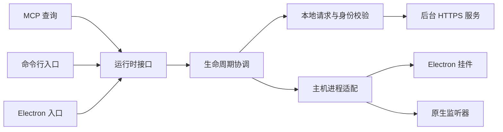

# 启动与退出的运行边界

版本：0.5.1。日期：2026-10-29。

插件命令、MCP 与 Electron 通过同一个运行时接口启动和停止。入口不再各自解释端口身份、构建、目录与就绪状态；生命周期流程集中管理，主机依赖由适配器提供。

| 模块 | 职责 |
| --- | --- |
| `plugin/runtime.js` | 绑定本机配置、凭据、证书、日志文件、进程创建与退出标记；对外保留原有接口并提供明确启动和停止方法 |
| `plugin/lifecycle.js` | 组织服务启动、挂件就绪、监听器恢复、显式重开和完整退出；合并同一进程中的并发操作 |
| `plugin/local-client.js` | 固定本地 TLS 请求、消息错误、目录规范化及服务身份校验 |
| `plugin/shutdown.js` | 写入退出标记，停止监听器，请求正常关闭，最后按所属路径核验后清理进程 |

后台服务负责无窗口时的额度与任务处理；Electron 负责挂件；原生监听器负责桌面跟随和自动打开。RPC 与队列仍属于任务执行层，不参与挂件就绪判定。本次收敛入口和生命周期契约，不改变任务调度与发送路径。

## 入口契约

- `ensureService()` 是被动查询：检查退出标记，复用当前服务，必要时以 `--observe-only` 冷启动。不会清除退出标记或开启保存的调度。
- `startService()` 是明确启动：等待正在进行的完整退出，清除当前模式的退出标记，再进入查询模式。
- `openWidget({ automatic })` 自动打开时遵守退出标记；手动打开时等待退出完成并清除标记。先确认服务，再启动挂件并等待真实就绪状态；手动打开按既有偏好恢复监听器。
- `stopService()` 只请求当前数据目录的服务关闭，保留命令行停止入口既有含义；服务不在时不启动它。
- `stopBackground()` 是挂件完整退出：沿用退出标记、监听器清理、正常关闭和所属进程核验流程。同一运行时中的并发退出共用一次流程。

并发服务查询共用一次启动。并发打开共用一个挂件启动与就绪等待；手动打开加入自动打开时只恢复一次监听器。完整退出会使旧启动代次失效，重开创建新的启动代次；旧服务响应和挂件等待不能被新请求复用，也不能清除新一轮的等待状态。

## 身份、时间与故障

服务查询和冷启动就绪检查均核验应用标识、协议、构建和规范化数据目录。命令行停止允许关闭同数据目录的旧构建，便于升级；挂件完整退出额外要求源码或安装根目录一致。进程强制清理继续使用既有 PowerShell 路径核验，不依赖单个端口或 PID。

只有未创建本地 TLS 身份或明确连接拒绝才触发启动；身份不匹配、TLS 错误、访问拒绝和其他网络错误直接返回。请求继续使用固定证书，每次请求重新读取当前凭据及 TLS 身份，不将凭据发送到其他来源。

常规 API 请求保留 35 秒超时。启动探测单次最多 2 秒；冷启动后的就绪等待使用 18 秒总预算，每次探测受剩余预算约束。挂件保留原来的 60 次、间隔 150 ms 检查，需满足当前构建、真实存活进程和首屏就绪条件。创建进程失败直接返回错误，失败后后续明确请求可重试。

构造生命周期不读写文件、不启动进程；执行时所有主机操作由注入的适配器完成。测试通过正式构造函数注入请求、启动器、诊断、时钟和退出标记。运行时错误提供稳定错误代码及消息标识，调用方不依靠中文文本分类。

## 验证

新增 `tests/runtime-lifecycle.test.js` 与 `tests/local-client.test.js` 共 23 项检查，覆盖并发启动与打开、启动与退出交叉、重新打开、旧代次响应和等待隔离、主机同步停机通知、身份及构建不符、就绪超时、进程创建失败、监听器归属与回退、旧构建停止、凭据更新和消息参数传递。

完整回归使用固定源码目录 `.cache/runtime-lifecycle-refactor-0.5.1/`。真实服务冷启动继续采用独立数据与模拟 RPC/消息通道，桌面验收使用隐藏 Electron 窗口。未运行安装器或更换用户正在使用的插件。

最终固定源码以两个测试文件并发运行：**354 项通过，0 失败、0 跳过**。语法检查、公开源码检查及差异空白检查通过，工作区与验证副本的 13 个修改文件已逐项核对哈希。完整回归包含真实 MCP 冷启动、跨数据目录拒绝、退出标记、所属进程清理、隐藏窗口就绪与退出，以及原生窗口反复展开；测试未启动真实任务或发送聊天消息。
